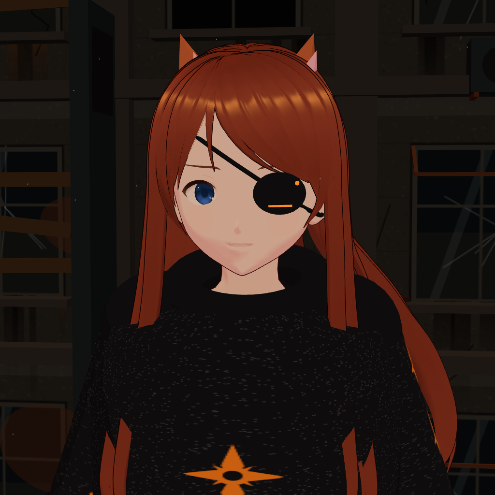

# STAGE / avatar viewer

アニメ調の 3D アバターを、荒廃した街の鉄骨の上に立たせて眺めるページです。ブラウザだけで動き、ビルドすると 1 つの HTML ファイルになります。



## できること

- ドラッグで回転、ホイールで拡大
- テーマ、カメラ、ポーズ、表情、顔つき、鼻の高さの切り替え
- 髪、目、服、くつの色替えと、トップスの柄
- パーカー、厚底ハイカット、眼帯、ねこ耳、ヘッドセットなどの小物
- 背景（荒廃都市、地下ドームなど）、ライト、空中の粒、立つ場所（鉄骨、ステージ台）
- くつから出る虹色の煙、浮遊ポーズ
- 正方形の画像保存
- 別の `.vrm` ファイルを画面にドロップして差し替え

## 構成

| 場所 | 内容 |
|---|---|
| `stage-live/main.js` | ページ本体。舞台、操作パネル、ポーズ、色替え |
| `stage-live/outfit.js` | パーカーとくつ。図形から組み立てて骨に追従させる |
| `stage-live/ruins.js` | 荒廃都市の近景（高架道路、鉄塔、クレーン、看板、火と煙） |
| `stage-live/nearcity.js` | 鉄骨と、その両端の作り込んだビル 2 棟 |
| `model/girl.glb` | 同梱のアバター（下記クレジット参照） |
| `tools/snap.mjs` | 画像書き出し用のスクリプト |
| `releases/v1.0/` | バージョン 1.0 の完成ページとソース |

## ビルド

```
npm install
node ~/.claude/skills/teardown/sims/build.mjs ./stage-live
```

出力は `teardown-out/dist/stage-live.html` です。ビルドには [elvarofficial/teardown](https://github.com/elvarofficial/teardown)（MIT）のビルドスクリプトを使っています。

## クレジット

- アバター: `VRM1_Constraint_Twist_Sample` (c) 2022 pixiv Inc.、[VRM Public License 1.0](https://vrm.dev/licenses/1.0/)。配布元は [vrm-c/vrm-specification](https://github.com/vrm-c/vrm-specification/tree/master/samples/VRM1_Constraint_Twist_Sample)。髪や目の色、鼻の形などはこのページの中で加工して表示しています。
- [@pixiv/three-vrm](https://github.com/pixiv/three-vrm)（MIT）、[three.js](https://threejs.org/)（MIT）
- 衣装、小物、背景は、特定のブランドや作品の意匠を写したものではなく、このプロジェクトで作ったものです。
